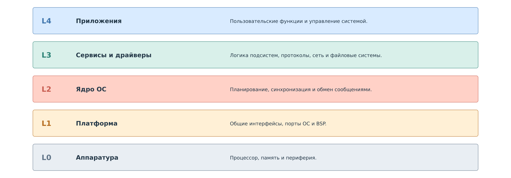
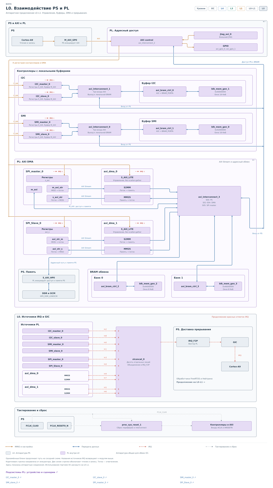
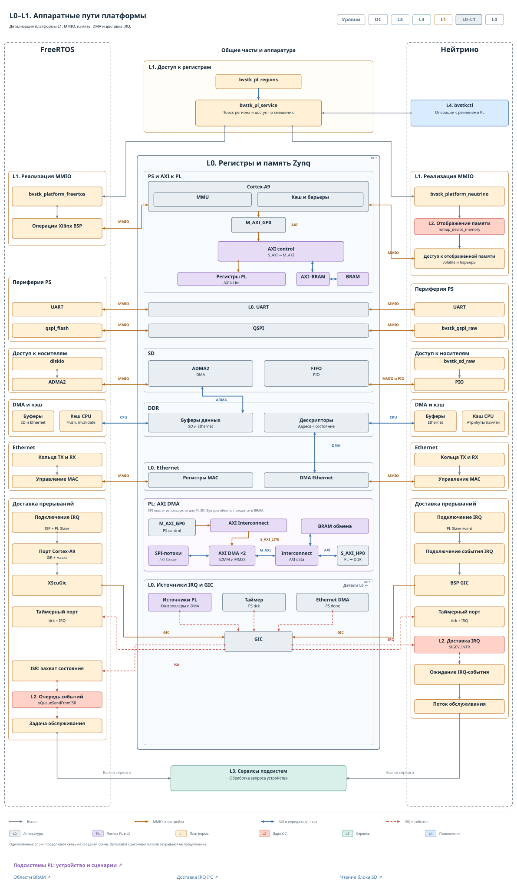
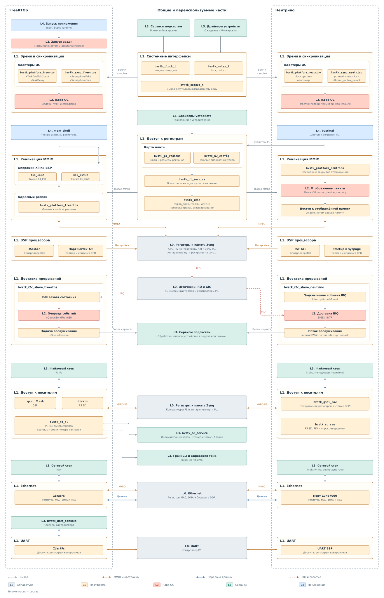
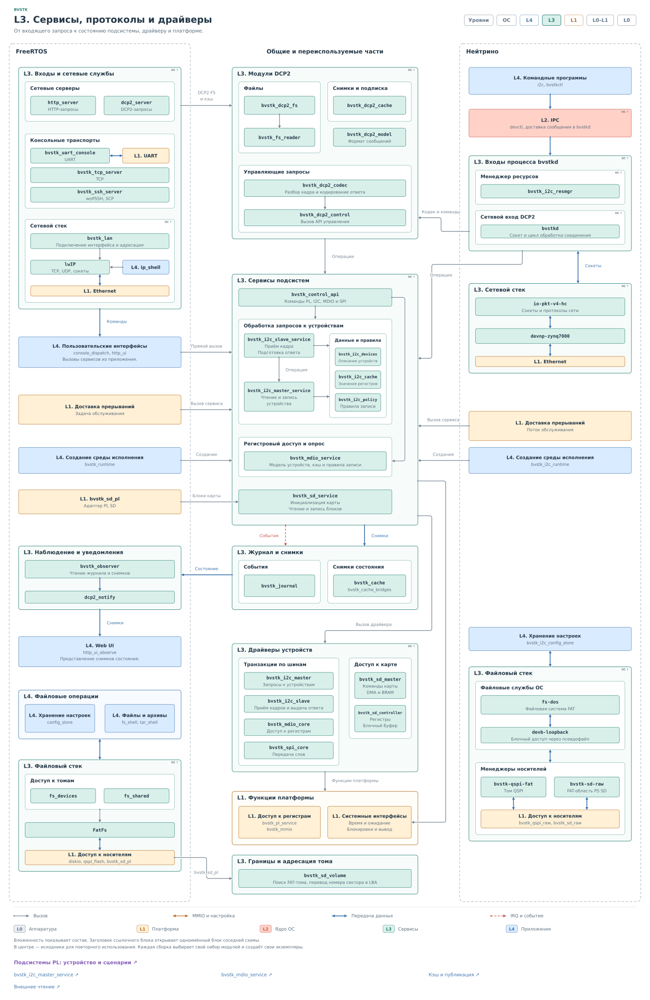
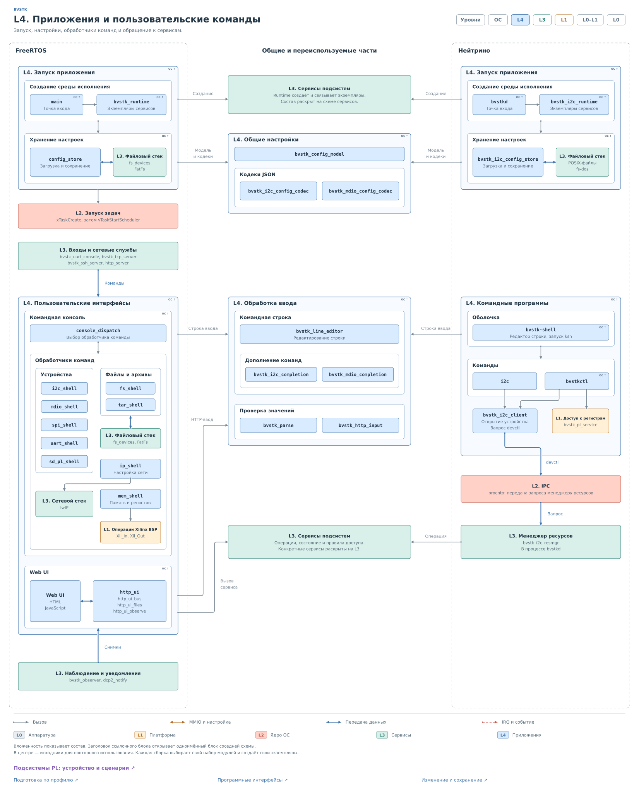
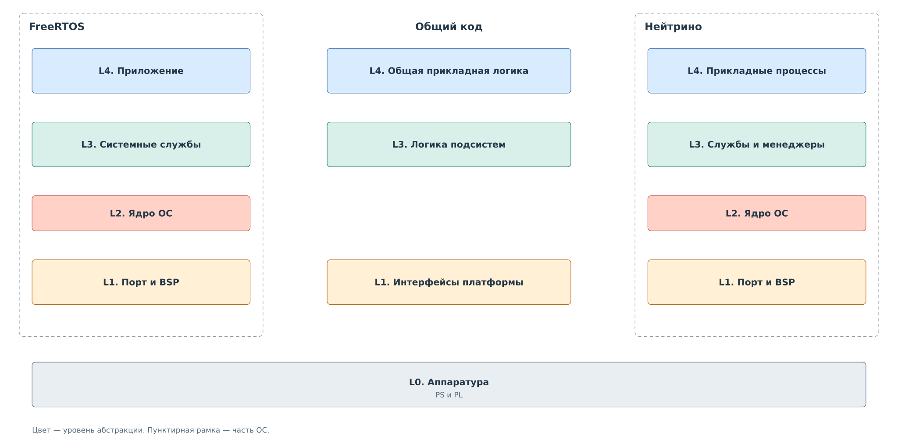

# Как устроена BVSTK

Представим ведущий контроллер, который читает и меняет регистры ведомого
устройства. BVSTK стоит между ними: со стороны контроллера она принимает
обращения как ведомое устройство, а со стороны устройства сама начинает
обмен как ведущий. Благодаря этому программа может выбирать источник
ответа и проверять запись до её передачи устройству.

*Рисунок 1. BVSTK: мост между устройствами.*

Проследим чтение одного регистра. Внешний ведущий сообщает, какое
значение ему нужно. BVSTK может ответить из ранее подготовленных данных
или получить значение у физического устройства. Когда ведущий захочет
изменить тот же регистр, появится ещё один шаг: проверка политики записи.
При запрете обращение к устройству не выполняется.

Эта последовательность объясняет устройство системы. Нужно принять
транзакцию в темпе шины, передать её смысл программе, подготовить данные
и вовремя вернуть ответ. Далее рассмотрим, как эти обязанности разделены
между аппаратурой и программой. В главах об I²C и MDIO тот же путь будет
разобран до конкретных модулей и событий.

## Зачем разделены PS и PL

BVSTK работает на Zynq-7000. В одном кристалле находятся процессорная
система **PS** и программируемая логика **PL**. В PS исполняется программа
под управлением ОС. В PL размещены аппаратные ядра внешних интерфейсов.

Ведущий на шине ожидает определённого поведения сигналов: адрес должен
быть принят, биты выданы в нужные моменты, подтверждение сформировано
на нужном такте. Эти действия выполняет PL. Программа PS работает
с более крупными сущностями: устройством, регистром, значением и правилом
доступа. Поэтому для изменения политики не требуется менять автомат,
который принимает биты шины.

У аппаратуры и программы разный ритм работы. Для передачи данных между
ними используется **BRAM** — память внутри PL, доступная и ядрам,
и процессору. Ядро может закончить приём байтов, а программа забрать
готовый фрагмент позднее. В обратную сторону программа сначала готовит
ответ, затем разрешает ядру использовать его. Допустимая задержка
зависит от внешнего протокола.

## Уровни абстракции

Чтобы последовательно описать этот путь, договоримся о пяти уровнях.

*Рисунок 2. Уровни абстракции BVSTK.*

**L0** — сама аппаратура: процессор, память, периферия PS и ядра PL.
**L1** предоставляет программе доступ к этой аппаратуре и средствам ОС.
**L2** — ядро ОС, которое планирует исполнение и доставляет системные
события. На **L3** находятся сервисы устройств, драйверы и протокольные
стеки. **L4** создаёт рабочую среду и предоставляет пользовательские
функции.

Номер уровня обозначает ответственность. Например, сервис L3 вызывает
драйвер L3, драйвер обращается к платформе L1, а её реализация использует
ядро L2 там, где нужны ожидание или синхронизация. Такой вызов не обязан
проходить через все уровни по порядку.

На рисунках цвет показывает уровень, фиолетовый выделяет PL внутри L0.
Вложенные блоки раскрывают состав. Одноимённые блоки позволяют продолжить
путь на следующем рисунке. Серые стрелки обозначают вызовы, коричневые —
доступ к аппаратным регистрам, синие — передачу данных, красные
пунктирные — прерывания и события.

## L0. Соединение PS и PL

Начнём с аппаратной стороны нашего примера. Внешний ведущий обращается
к ведомому ядру PL. Для получения нового значения программа должна
запустить другое, ведущее ядро на стороне физического устройства.
Между этими ядрами нет обязательной передачи транзакции напрямую:
их действия связывает программа PS.

*Рисунок 3. L0. Взаимодействие PS и PL.*

Процессор управляет ядрами через их регистры. В них задаются команда,
адрес или признаки готовности; из них читается состояние операции.
Обращения проходят по внутренней шине AXI через порт PS `M_AXI_GP0`.

Ядра I²C и MDIO сами читают и записывают свои области BRAM. PS имеет
доступ к тем же областям. Для SPI предусмотрены потоки данных и DMA —
узлы, переносящие данные между потоком и памятью. Действующий путь
к карте SD использует SPI master и BRAM банка 0. Различия этих способов
обмена будут раскрыты в главах о подсистемах.

## L0–L1. Аппаратные пути

Доступность памяти ещё не говорит программе, когда в ней появился
законченный запрос. Для этого у ядра есть признаки состояния,
а в нужных случаях — прерывание, или IRQ.

*Рисунок 4. L0–L1. Аппаратные пути платформы.*

При обычном доступе процессор читает и записывает аппаратные адреса.
Такой способ управления регистрами называется **MMIO**. При передаче
через DMA процессор задаёт область и размер, после чего данные
перемещает аппаратный узел. Драйвер учитывает, какой из этих путей
использует конкретная подсистема.

Прерывание от PL поступает в контроллер прерываний GIC, затем —
в обработчик выбранного порта ОС. Оно привлекает внимание программы
к событию. Сам запрос остаётся в BRAM, а его длина и состояние
определяются протоколом обмена с ядром. В других операциях, например
в текущем драйвере I²C master, программа ожидает результат опросом
регистров состояния.

При работе с памятью PS и DMA также учитывается кэш процессора:
он влияет на видимость данных для аппаратуры. Далее под кэшем
устройства будет пониматься отдельная программная структура со
значениями регистров. Её назначение — подготовка ответов и наблюдение
за устройством.

## L1. Платформа и обращение к ядру ОС

После события от ведомого ядра программе нужно прочитать буфер,
вызвать обработку и записать ответ. Общий код этих действий получает
доступ к аппаратуре через интерфейсы платформы.

*Рисунок 5. L1. Платформа и аппаратные события.*

Например, `bvstk_mmio` позволяет драйверу работать с аппаратным регионом.
Описание платы задаёт его адрес и размер. Во FreeRTOS операции
реализованы средствами Xilinx BSP. В Нейтрино порт сначала отображает
регион в адресное пространство процесса. Алгоритму драйвера достаточно
знать доступные операции чтения и записи.

Тот же принцип используется для времени и блокировок: `bvstk_clock_t`
и `bvstk_mutex_t` связывают общий код с реализацией выбранной ОС.
Блокировка нужна, например, чтобы две программные команды не загрузили
перемешанные данные в одно ведущее ядро.

Порт также определяет, где продолжится обработка IRQ. Во FreeRTOS
короткий обработчик сохраняет событие в очередь, которую читает задача.
В Нейтрино ядро ОС пробуждает ожидающий поток. После этого вызывается
общий сервис. Подробная последовательность приведена в
[главе о программе PS](pl-subsystem/ps-interaction/ps-interaction.md#событие-от-ведомого-i2c).

## L3. Сервисы, протоколы и драйверы

Теперь запрос дошёл до кода, который понимает его смысл. **Сервис**
знает, какому устройству принадлежит регистр, разрешена ли запись
и можно ли использовать сохранённое значение. **Драйвер** знает,
как загрузить команду в аппаратное ядро и получить результат.

*Рисунок 6. L3. Сервисы, протоколы и драйверы.*

В I²C ведомый сервис разбирает обращение внешнего ведущего. Для чтения
он сначала проверяет кэш. Если подходящего значения нет, ведущий
сервис вызывает драйвер и получает байт от устройства. Результат
возвращается ведомому сервису, записывается в окно ответа BRAM
и становится доступен ведомому ядру. Так замыкается путь от внешнего
запроса до ответа.

При записи в тот же регистр ведущий сервис сначала проверяет политику.
Разрешённая операция доходит до драйвера; запрещённая завершается
до запуска ведущего ядра. При этом ведомое ядро уже могло подтвердить
приём байтов на внешней шине. Аппаратное подтверждение приёма
и результат программной обработки относятся к разным моментам.

Команда из консоли или сетевого интерфейса также может вызвать сервис.
Поэтому правила работы с устройством сосредоточены в сервисе, а входной
протокол отвечает за доставку запроса и возврат результата клиенту.
В MDIO эти обязанности выполняет `bvstk_mdio_service`; там ответ
внешнему ведущему заранее подготовлен в BRAM.

## L4. Запуск и пользовательские функции

До первого обращения нужно определить, какие устройства обслуживаются
и какие правила к ним применяются. Это делает приложение при запуске:
загружает профили, создаёт сервисы, связывает их с драйверами и запускает
обслуживание. Полученная рабочая среда сохраняется между транзакциями.

*Рисунок 7. L4. Приложения и пользовательские команды.*

Во FreeRTOS запуск проходит через `main` и `bvstk_runtime`. Консольные
команды направляются через `console_dispatch` в обработчики, такие как
`i2c_shell` и `mdio_shell`. HTTP-обработчики предоставляют доступ
к функциям из Web UI. Общие разборщики команд и кодеки конфигурации
переиспользуются этими входами.

В Нейтрино рабочей средой I²C владеет процесс `bvstkd`. Командный клиент
передаёт запрос через `devctl`; менеджер ресурса внутри `bvstkd`
получает его и обращается к сервису. Несколько клиентов таким образом
работают с одним состоянием подсистемы.

Изменение правила влияет на дальнейшие операции работающего сервиса.
Сохранение профиля определяет, с какими правилами система запустится
в следующий раз. Эти действия разобраны отдельно в
[разделе о настройках](pl-subsystem/ps-interaction/ps-interaction.md#настройки-и-сохранение).

## Два варианта исполнения

Рассмотренный путь сохраняет смысл в обеих ОС. Различаются способ
запуска, доставка событий и организация исполнителей.

*Рисунок 8. BVSTK в двух ОС.*

Во FreeRTOS BVSTK собирается в одно приложение с задачами. В Нейтрино
служба `bvstkd`, командные клиенты и менеджеры носителей работают
отдельными процессами. Общие исходники содержат модели устройств,
сервисы, драйверы и обработку протоколов. Каждая сборка создаёт
собственные экземпляры этих структур.

Наличие общего кода не означает одинакового состава запущенных функций.
В FreeRTOS подключены I²C, MDIO и файловый доступ к SD через PL.
В Нейтрино действует программный путь I²C; среда MDIO пока не запускается.
Точный состав приведён в [таблице возможностей](../reference/profiles.md).

### Файловый доступ

Для загрузки и сохранения профилей приложение использует файловый слой.
Во FreeRTOS `fs_devices` связывает тома с FatFs: QSPI доступна как
`flash:/`, карта PS SD — как `sd:/`, карта через PL — как `sd-pl:/`.
В Нейтрино носители обслуживают отдельные менеджеры и файловые службы;
основные точки монтирования — `/flash` и `/sd`.

Работа с носителями вынесена в [руководство по файловому доступу](../operations/files.md).
Путь от файлового запроса до карты PL SD раскрыт в
[главе SPI и SD](pl-subsystem/spi/spi.md#чтение-блока-sd).

## Дальнейший путь

Теперь у нас есть общий маршрут: ядро принимает обращение, программа
выбирает действие, драйвер при необходимости получает новое значение,
а ведомое ядро выдаёт подготовленный ответ. Следующий вопрос — как
согласовать эти этапы во времени и какие данные хранить между ними.
Ему посвящена глава [«Подсистемы PL»](pl-subsystem/pl-subsystem.md).

Далее [программа PS](pl-subsystem/ps-interaction/ps-interaction.md)
объяснит работу профиля, политики и кэша. В [главе I²C](pl-subsystem/i2c/i2c.md)
прочитаем один регистр и проследим тот же запрос до аппаратных автоматов.
Главы [MDIO](pl-subsystem/mdio/mdio.md) и [SPI и SD](pl-subsystem/spi/spi.md)
покажут, как организация обмена меняется при другом протоколе.

Адреса и границы областей собраны в [карте памяти](pl-subsystem/reference/reference.md).
Реализации модулей можно найти по [карте исходников](../development/source-map.md).
